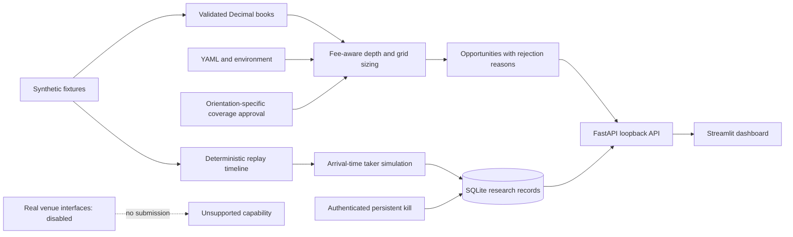

# Architecture

Financial models reject floats and nonfinite decimals. Serialization emits strings; all trading
arithmetic uses Decimal. Book receive age and skew use local monotonic nanoseconds; audit
records use timezone-aware UTC. Replay uses an explicit synthetic millisecond time axis, not
host time. Fixed demo timestamps intentionally remain fixed.

Pricing walks executable asks, charges per-consumed-level synthetic fees, searches the exact
common quantity grid, and chooses maximum feasible net profit. The search has a hard step
ceiling and rejects oversize grids rather than sampling and overlooking fee boundaries.
This reference algorithm favors correctness on small offline books over feed-scale throughput.

A bounded feed primitive invalidates its book on overflow. The book manager invalidates on
identity/version mismatch and duplicate, out-of-order or gapped synthetic sequences. Only a
new snapshot restores validity. This does not implement real feed bootstrap or reconnect.

Storage has an append-only application API for versioned records, reservations and persistent
system state. SQLite writers serialize before reading capacity. Fill IDs deduplicate within
venue, and a transaction writes both fill and cash delta. The application does not expose SQL
mutation endpoints. Database owners can still modify tables; cryptographic tamper resistance
is not implemented.

Paper orders consume only depth available at arrival, below their price cap. Consumption is
conservatively retained across snapshots by venue/market/outcome/price, so replenishment is
not assumed. Replay callers process arrivals in time order. A replay restart is a new independent
simulation. No passive orders or queue-position assumptions exist.

The state transition table lives in `app/execution/state.py`. Its standalone validation does not
implement a durable live coordinator. Real venue subclasses inherit explicit unsupported
errors. `require_live` rejects unconditionally; configuration and arm requests cannot bypass it.
